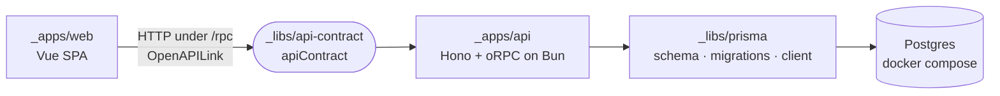

# Canonical Repo

The starter monorepo every new project begins from: a Hono + oRPC API on Bun, a Vue 3 SPA typed from the same contract, Prisma on Postgres, built by turbo out of one strict pnpm catalog and linted by oxlint. Its `templates.json` makes it the template source the intentic scaffolder injects apps from.



## Getting started

Needs Node 24, pnpm 12, Docker and `openssl` on `PATH`.

```sh
pnpm install     # also writes .env from .env.example and mints this machine's dev certificate
pnpm cert:trust  # once per machine: trust that certificate in the OS and browser stores
pnpm dev         # Postgres up, migrations applied, api + web through turbo
```

- Web: `https://localhost:4801`
- API health: `https://localhost:6580/health`

## Layout

Every top-level directory starting with `_` is an area, and each directory inside it with a `package.json` is a package named `@app_/<directory>`; `pnpm-workspace.yaml` globs them, so a new package needs no registration.

```text
_apps/                  deployables, one directory per app instance
  api/                  Hono + oRPC on Bun, run from source (Dockerfile: pruned tree + migrations on boot)
  web/                  Vue 3 + Vite + Vue Router + TanStack Query (Dockerfile: nginx + runtime env)
_libs/                  shared packages
  api-contract/         the oRPC contract and Zod schemas both ends are typed from
  prisma/               schema, migrations, generated client, the CLI's config
_tools/
  constants/            repoRoot(), importable before install or build
  localhost-https/      per-user dev CA + localhost certificate, minted on install
  scripts/              prepare (hooks, .env), clear, docker-release + registry retry
  tsconfig/             strict base and Vue variant
```

## Commands

- `pnpm dev`: start Postgres, apply migrations, run every package's `dev`.
- `pnpm check`: lint, format check, typecheck (tests included) and test; what CI should run.
- `pnpm build` / `pnpm typecheck` / `pnpm test`: turbo, each package after its dependencies.
- `pnpm lint` / `pnpm lint:fix` / `pnpm format`: oxlint and Prettier.
- `pnpm db:up` / `pnpm db:down` / `pnpm db:reset`: Postgres and migrations; reset drops the volume.
- `pnpm db:migrate`: author a migration from a `schema.prisma` change (`prisma migrate dev`).
- `pnpm db:studio`: Prisma Studio.
- `pnpm docker:release`: build and push every app's image (see Docker below).
- `pnpm clear`: remove every `node_modules`, `.cache`, `dist`, `.turbo` and `generated`.

## How it is put together

### One catalog

Every third-party version is an exact pin in `pnpm-workspace.yaml`'s catalog, and a manifest writes `catalog:`. `catalogMode: strict` makes `pnpm add` refuse a version the catalog does not carry, `savePrefix: ""` keeps carets out, and `catalogPrune` drops pins nothing uses. Packages that may run install scripts are listed in `allowBuilds`. Vue's type checker still needs TypeScript's JavaScript API, so the web takes `typescript` from the `typescript6` named catalog while everything else compiles with TypeScript 7's native `tsc`.

### Source inside the repo, dist outside it

A library's `exports` map lists an `@app_/src` condition ahead of `types` and `default`. Everything that runs inside the repository asks for it: the base tsconfig's `customConditions`, Bun's `--conditions=@app_/src` in the api's `dev` and `test`, and Vite's `resolve.conditions`. An edit to a library is therefore live in the type checker, the dev servers and the tests without a build. Anything outside the repository, including the api image, which runs without the condition, gets `dist/`. Prisma's condition points at `client.ts`, which re-exports the generated client, so turbo's `^build` (`prisma generate`) runs before every `dev`, `typecheck` and `test`.

### Environment

- **The api** describes its whole configuration as one Zod schema in `_apps/api/src/env.config.ts`, loaded by `@puristic/env`. Each path becomes an environment name (`database.url` → `DATABASE_URL`) and a flag (`--database-url`). Sources merge in order, later wins: the root `.env`, then the process environment, then CLI flags. A leaf marked `.meta({ secret: true })` is masked when the config is logged at boot, and `purenv` can encrypt it in place. The default export is the definition `purenv` and its editor extension discover.
- **The root `.env`** is git-ignored and seeded from `.env.example` on install. The api, the Prisma CLI and docker compose read it. A container gets the same names from its deployment instead.
- **The web** has no build-time environment. `index.html` loads `/assets/js/env.js`, which sets `window.env` before the app starts:
  - In dev, esbuild bundles `environment.local.ts` with `$API_URL` from the shell.
  - In the image, `environment.deployment.ts` is bundled with a literal `$API_URL`, which the entrypoint substitutes at container start and inlines into `index.html`. One build artifact serves every environment.
- **Turbo runs in strict env mode**: a task sees only what `turbo.json` names. A variable a task should read goes in its `env` (hashed) or `passThroughEnv` (not hashed).

### Docker

- `docker-compose.yml` holds local infrastructure only (Postgres). It has no `name:`, so each checkout's containers and volumes stay apart.
- `pnpm docker:release` runs each app's `docker:release` after `build`, through `_tools/scripts/docker-release.sh`. Images are named after the package without its scope, and settings come from the environment:
  - `REGISTRIES` (required) is the space-separated list of registries that get every tag.
  - `TAGS` defaults to `latest`, plus `sha-<8>` when `GITHUB_SHA` is set.
  - `PUSH=0` builds locally without touching a registry.
  - Every image is also tagged `turbo-<hash>` from turbo's per-task content hash. An image already pushed under that tag is only re-tagged, never rebuilt, and the web image reports the tag as its `X-Web-Build` header.
- **api**: the build context is `pnpm deploy --prod` of the api into a temporary directory outside the repo: the api's source, its production dependencies and its workspace packages at their `dist`. Before serving, the container applies pending migrations and then refuses to boot if the live schema differs from the build's (`prisma migrate diff --exit-code`). `exec` makes bun PID 1, so SIGTERM shuts it down cleanly.
- **web**: `dist` behind nginx. `.dockerignore` admits only `dist`, `nginx.conf` and `entrypoint.sh`. The entrypoint renders both templates with an explicit `envsubst` variable list, so nginx's own `$uri` survives.

```sh
REGISTRIES=local PUSH=0 pnpm docker:release
docker run --rm -p 6580:6580 -e DATABASE_URL=… -e WEB_ORIGIN=http://localhost:8180 local/api
docker run --rm -p 8180:80 -e API_URL=http://localhost:6580 local/web
```

### Local HTTPS

`pnpm install` mints a development CA and a `localhost` certificate into the per-user data directory, outside the repository, so no private key can ever be committed. The CA is name-constrained to localhost and loopback. The api and Vite serve https with it; `pnpm cert:trust` adds the CA to the OS, Firefox and (from WSL) Windows stores.

Behind a preview proxy, which sets `PORT`, both servers bind that port and speak plain http, because the proxy terminates TLS itself.

### Commits and lint

- `prepare` points git at `.githooks/`, whose `commit-msg` hook checks Conventional Commits with commitlint. It prints what it finds and never refuses the commit.
- `.oxlintrc.json` enumerates its rules rather than enabling categories, so an oxlint upgrade cannot silently change what is enforced. Each rule that is off says why.

## As a template source

`templates.json` tells the intentic scaffolder how to assemble a new monorepo from this one:

- `shell`: the root files copied once.
- `shared`: the `_tools` packages copied once.
- `templates`: per-app `instance` packages. A directory under `_apps/` is copied per instance and renamed to it (`_apps/api` → `_apps/shop-api`, `@app_/api` → `@app_/shop-api`); everything else keeps its name and lands once.
- `previews`: how each app runs behind the sandbox's preview proxy. `{port}` mirrors the injected `PORT`, and `{previewUrl:<package>}` is a sibling app's address.

Root scripts never name an app, so they stay correct for any instance names; scripts that name a shared package (`@app_/prisma`) do nothing when it is absent.
